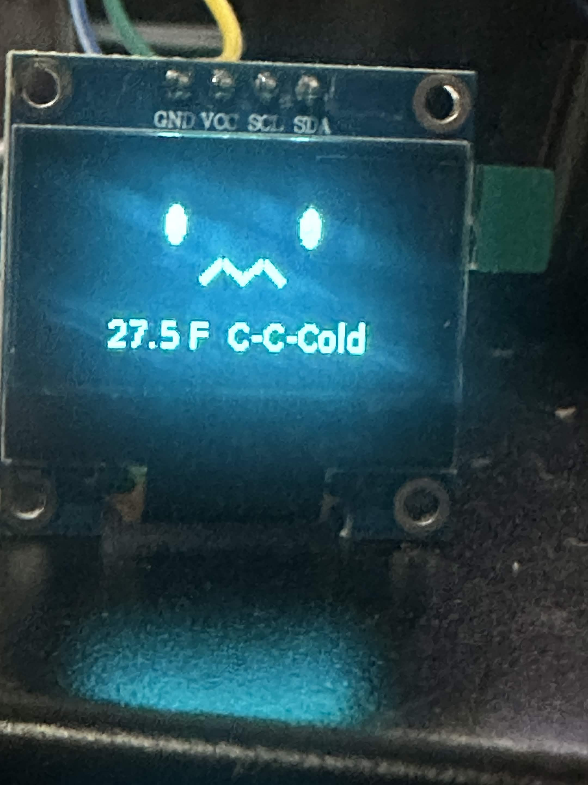
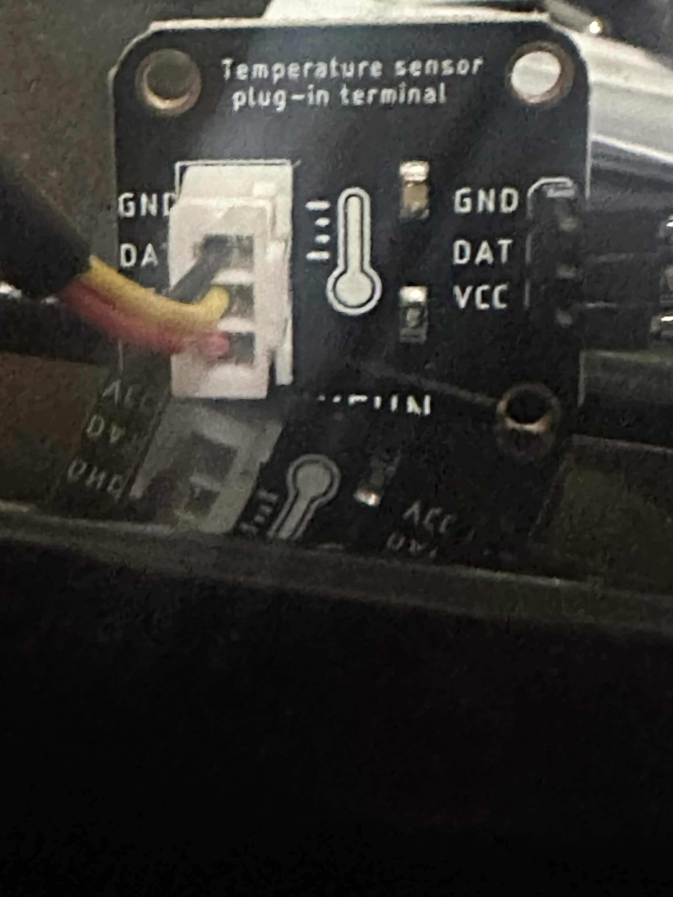
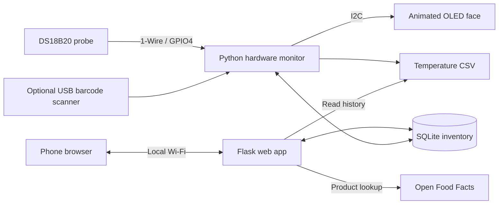

# BMO Fridge Buddy

BMO Fridge Buddy is a Raspberry Pi fridge monitor with an animated BMO-inspired
OLED face, live temperature tracking, and a Flask/SQLite web app for food
inventory and expiration dates.
Built with a Raspberry Pi 5, a waterproof DS18B20 probe, a 128 x 64 I2C OLED,
Python, Flask, and SQLite.

## Online app

**[Try BMO Fridge Buddy on Vercel](https://bmo-fridge-buddy.vercel.app/fridge)**

The Vercel version is deployed with Neon Postgres and a private owner password.
Its inventory is separate from the original site and the Pi. Live checks passed
for sign-in, saving, persistence after refresh, editing, removal, sign-out, and
browser layouts from 360 to 1280 pixels. Physical phone-camera testing and the
Pi temperature connection are still pending. See [Vercel setup](vercel-app/README.md).

The original site remains available:

**[Open BMO Fridge Buddy](https://bmo-fridge-buddy-farha.jollymatch2.chatgpt.site)**

This private online app stays available when the Pi is off. Sign in with the
owner account. Add food by name, scan barcodes or supported food QR labels,
track quantities and expiration dates, search, edit, and remove food.

The cloud app has its own persistent database. Existing Pi inventory is not
automatically imported. Temperature uploads need to be configured on the Pi;
until then the app shows Pi offline. Actual phone camera validation is pending.
See [cloud app and Pi connection setup](cloud-app/README.md).

The Flask instructions below describe the separate local Pi version, whose
links require the Pi to be powered on.

## Hardware demo

**[Watch or download the recorded startup and hardware demo](docs/media/bmo-hardware-demo.mov)**

The recording captures the physical prototype. Depending on the browser,
the MOV file may download instead of playing inline.

### Temperature expressions on real hardware

| Normal: 35.3 F | Warm: 41.7 F | Cold: 27.5 F |
|:---:|:---:|:---:|
|  |  |  |

### Hardware connections

| Raspberry Pi 5 | Temperature probe adapter |
|:---:|:---:|
|  |  |

The Pi and adapter stay outside the fridge; only the waterproof metal probe
goes inside. These photos document the prototype, not a pin-by-pin wiring guide;
see [setup and wiring instructions](TODO.md#oled-wiring) for the connections.

**Verified on the Pi:** sensor detection and valid readings, response to
warming and cooling, OLED communication at I2C address `0x3C`, startup
animation, blinking, and temperature-dependent expressions. The photos above
show all three temperature bands on the physical OLED.

**Next validation:** exercise the phone inventory workflow on a real phone,
inspect the logged temperature graph, and complete an extended fridge run.
The probe has not yet been checked against a reference thermometer.

## What I built

I built this project to connect embedded hardware with a useful application:
read a physical sensor, animate a constrained display, persist inventory and
temperature data, and expose food tracking through a local web interface.

The software implements:

- Read the fridge temperature with a Gikfun EK1183 waterproof DS18B20 probe and
  adapter module.
- Show a BMO face, temperature, and fridge status on an OLED screen.
- Report whether the fridge is too cold, normal, or too warm.
- Accept barcodes typed manually, scanned with a phone, or scanned from an
  optional USB scanner.
- Look up product names using Open Food Facts.
- Store food quantities and expiration dates in a local SQLite database.
- Warn about food that is expiring soon.
- Save temperature history to a CSV file.
- Graph recent temperature history with a highlighted 32-40 F configured fridge range.
- Give BMO sleepy, happy, cold, and worried expressions based on temperature.

## How it works



The OLED shows just the face, temperature, and a short status. Inventory and
longer messages belong in the phone interface and terminal because the screen
is only 128 x 64 pixels. Sensor conversion runs in a separate thread so the
display can animate while a temperature read waits for the probe.

| Reading | OLED behavior |
|---|---|
| Startup | Closed eyes, then open eyes; `BMO waking up...` |
| Below 32 F | Zigzag mouth and `C-C-Cold`; brief `Brrr!` reaction on entering cold |
| 32-40 F | Smiling face and `Normal` |
| Above 40 F | Worried face and `Warm` |
| Sensor unavailable | Sleepy face and `No sensor` |

These are configured temperature bands, not a determination of whether an
individual food is safe. Quantity and expiration tracking depend on user input.

The main application is [bmo_fridge.py](bmo_fridge.py). Current progress,
remaining setup, wiring, testing, and update instructions are in
[TODO.md](TODO.md).

## Phone inventory and barcode scanner

The phone-friendly web app can scan a product barcode, look up its name with
Open Food Facts, save quantity and expiration date, list the fridge inventory,
remove items, and graph temperature history. Different expiration dates are
kept as separate batches even when the barcode is the same. The phone and OLED
share the same BMO mood rules. The OLED expressions have been tested on the
physical screen; the complete phone workflow still needs device validation.

The OLED reserves its screen for a blinking BMO face and one compact footer
with temperature and Cold, Normal, Warm, or No sensor status. A short closed-eye
wake-up animation plays at startup. Inventory and scan messages stay in the
phone interface and terminal. Sensor reads run separately from animation;
the probe's conversion time and physical response still limit how quickly a
temperature change appears. Warm means above the project's 40 F fridge limit.

On the Raspberry Pi:

```bash
cd ~/bmo_fridge_buddy
source .venv/bin/activate
python -m pip install -r requirements-rpi.txt
python web_app.py
```

Find the Pi's current address with `hostname -I` in another terminal, then open
`http://<PI-IP>:5000` from a phone on the same private Wi-Fi. For example, if
the address is `192.168.50.174`, open `http://192.168.50.174:5000`.
Manual barcode entry and the
**Take photo** option work from this local page. The ZXing barcode reader is
stored in this repository, so the scanner itself loads without internet
access. Product-name lookup still needs internet and falls back to an editable
`Unknown item` name when offline. Continuous **Live scan** camera access
requires a trusted HTTPS certificate because mobile browsers block live camera
streams on insecure pages.

### Resume after powering off

Before putting the Pi away, type `quit` at the monitor's `scan>` prompt (or
press Ctrl+C to stop a running web server), then run `sudo shutdown -h now`.
Wait for shutdown to complete before unplugging power.

When returning, power on the Pi and open a terminal:

```bash
cd ~/bmo_fridge_buddy
source .venv/bin/activate
hostname -I
python web_app.py
```

Leave that terminal running and visit `http://<PI-IP>:5000` on your phone.
The IP address can change after a reboot. To run the OLED and keep recording
temperature history too, open a second Pi terminal:

```bash
cd ~/bmo_fridge_buddy
source .venv/bin/activate
python bmo_fridge.py
```

Next device test: open the inventory page and temperature graph, add a manual
item, scan a barcode and a food QR label, then edit and remove those items.

For HTTPS, set paths to a trusted certificate and matching private key before
starting the server:

```bash
export BMO_TLS_CERT=/path/to/certificate.pem
export BMO_TLS_KEY=/path/to/private-key.pem
python web_app.py
```

Keep this development server on a trusted home network. Do not expose it
directly to the public internet; Version 2 does not yet include user accounts.

## Install as an always-on Pi service

After testing both applications manually, install the web app, hardware
monitor, and daily backup timer:

```bash
cd ~/bmo_fridge_buddy
git pull --ff-only
source .venv/bin/activate
python -m pip install -r requirements-rpi.txt
bash scripts/install_pi_services.sh
```

The installer starts both applications after every boot and immediately makes
a verified inventory backup. It then keeps 14 daily backups in
`~/bmo_fridge_backups`. Check them with:

```bash
sudo systemctl status bmo-fridge-web bmo-fridge-monitor bmo-fridge-backup.timer
ls -lh ~/bmo_fridge_backups
```

These copies protect against accidental database changes or corruption. They
remain on the same SD card, so occasionally copy the backup folder to another
computer if protection from complete SD-card failure matters.

## Private trusted HTTPS for live scanning

The recommended HTTPS option is Tailscale Serve. It keeps BMO private to your
Tailscale devices, provides a trusted certificate, and lets the web server
listen only on the Pi itself. Install Tailscale on the Pi and phone, sign both
into the same account, then run on the Pi:

```bash
sudo tailscale up
cd ~/bmo_fridge_buddy
bash scripts/enable_tailscale_https.sh
```

The command prints the private `https://...ts.net` address to open on the
phone. Do not enable Tailscale Funnel; this project is intended to remain
private rather than publicly accessible.

## Local app availability and adding your own food

The local Flask app is hosted on the Pi. Its local and Tailscale links require the
Pi to be powered on and the web service running. Installing the services starts
the app at boot; it does not make the app available while the Pi is off.
The web app can also run on a computer without sensor or OLED hardware:
install Flask and Waitress, then run `python web_app.py`. Inventory is stored
on that computer, separately from the Pi database. This local mode does not synchronize
with either hosted inventory database.

Leave Barcode blank to add produce, leftovers, or other perishables by name.
Enter quantity and an optional expiration date. Edit saved items to correct
names, quantities, or dates; remove one serving or an entire batch. Manual
entries stay separate so foods with the same name are not accidentally merged.
Dates are entered by you; ordinary product barcodes do not supply expiration dates.

Live scan and Take photo accept product barcodes and food QR labels. To make a
food QR label, encode a JSON object such as:

```json
{"name":"Leftover soup","quantity":2,"expires_on":"2026-11-15"}
```

An optional `barcode` field can contain 4 to 18 digits. Review scanned details
before saving. QR codes containing websites or other formats are rejected with
a message; scanning does not visit their links. Live camera scanning requires
trusted HTTPS (or localhost on the computer serving the app). Real-phone camera
validation is still required.


## Vercel migration status

The [Vercel version](https://bmo-fridge-buddy.vercel.app/fridge) is deployed with
the same BMO interface, persistent Neon Postgres storage, private owner sign-in,
and a device token for temperature uploads. It has no Sites/ChatGPT runtime
dependency. The production inventory workflow has been checked in a browser.
Existing Sites/Pi inventory has not been copied, and the original site remains
available while the Vercel version is tried. See [deployment notes](vercel-app/README.md).
