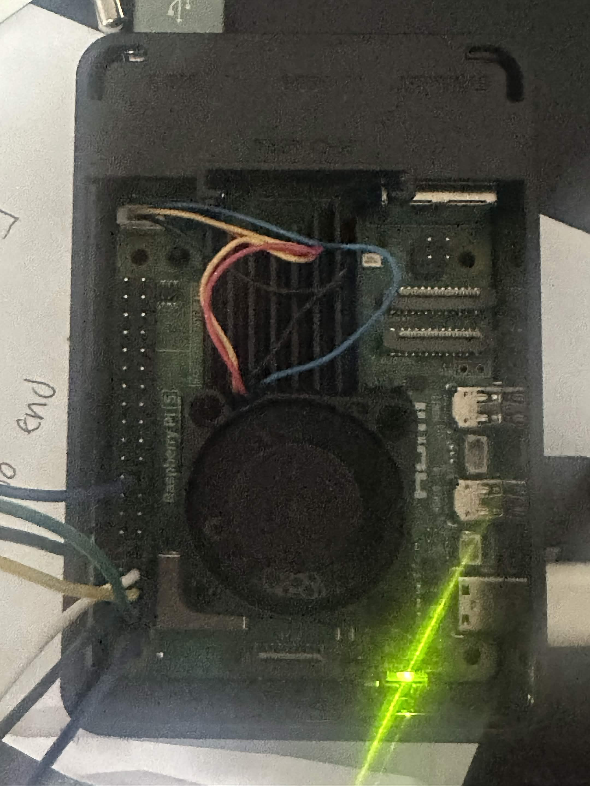
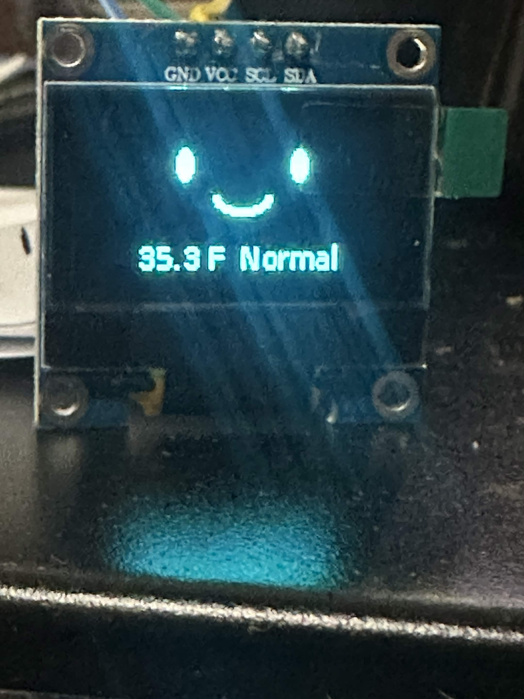
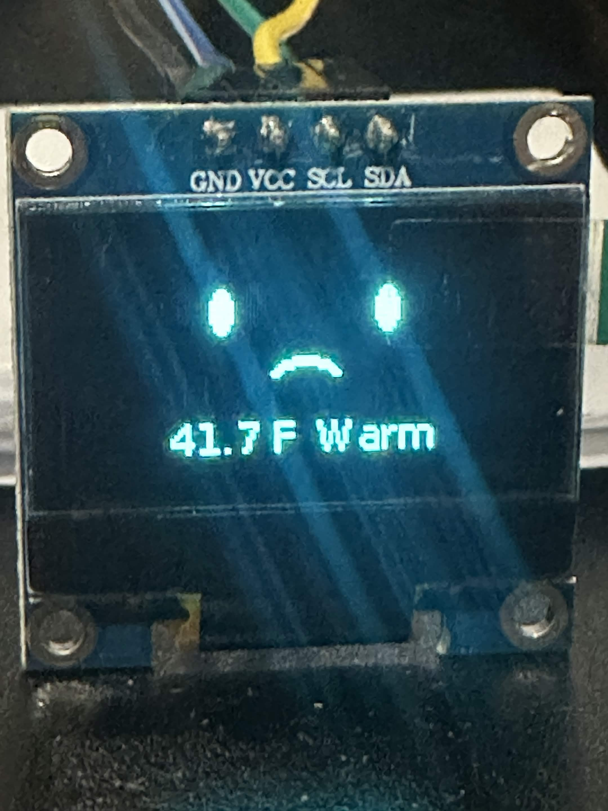

# BMO Fridge Buddy

I wanted a way to keep an eye on my fridge temperature and what food I had inside. I also wanted an excuse to build something with a Raspberry Pi, so I gave it a little BMO face inspired by *Adventure Time*.

BMO reads the temperature with a probe, shows it on an OLED screen, and changes expressions when the fridge gets too warm or too cold. There?s also a web app for food inventory and expiration dates.

[GitHub repository](https://github.com/FarhnChy/BMO_Buddy) | [Current app (owner login required)](https://bmo-fridge-buddy.vercel.app/fridge)

**Public demo:** I still need to make a version recruiters can try without a password. The current app uses a private owner login.



- Raspberry Pi and DS18B20 probe for temperature readings
- OLED face that reacts to the temperature
- Food inventory, expiration dates, barcode lookup, and temperature history

## BMO in action

The OLED changes its expression as the temperature changes. These photos are from the physical prototype.

| Normal: 35.3 F | Warm: 41.7 F | Cold: 27.5 F |
|:---:|:---:|:---:|
|  |  |  |

[Watch the hardware recording](docs/media/bmo-hardware-demo.mov) (the file may download depending on your browser). I plan to add a short GIF from this video and screenshots of the app.

## What it does

- Reads fridge temperature and records its history.
- Shows BMO?s face, the temperature, and a short status on the OLED.
- Tracks food, quantities, and expiration dates.
- Looks up products using barcodes and Open Food Facts.
- Shows a temperature graph in the web app.

## How I built it

The hardware uses a Raspberry Pi 5, a waterproof DS18B20 probe, and an I2C OLED. Python reads the probe and updates the display. The local web app uses Flask and SQLite; the hosted version uses Neon Postgres. The Pi and electronics stay outside the fridge, with only the waterproof probe inside.

The sensor and OLED have been tested on the Pi, including the startup animation and the three temperature expressions above. I still need to test the phone workflow, compare the probe with a reference thermometer, and run it in the fridge for a longer period. The hosted app also needs its Pi temperature connection configured.

I?m still working on a password-free demo with separate sample data, so people can try the inventory features without accessing my own fridge data. More setup and testing notes are in [TODO.md](TODO.md), and the hosted app setup is in [vercel-app/README.md](vercel-app/README.md).

## Phone inventory and barcode scanner

The phone-friendly web app can scan a product barcode, look up its name with
Open Food Facts, save quantity and expiration date, list the fridge inventory,
remove items, and graph temperature history. Different expiration dates are
kept as separate batches even when the barcode is the same. The phone and OLED
share the same BMO mood rules. The OLED expressions have been tested on the
physical screen; the complete phone workflow still needs device validation.

The OLED reserves its screen for a blinking BMO face and one compact footer
with temperature and Cold, Normal, Warm, or No sensor status. A short closed-eye
wake-up animation plays at startup. Inventory and scan messages stay in the
phone interface and terminal. Sensor reads run separately from animation;
the probe's conversion time and physical response still limit how quickly a
temperature change appears. Warm means above the project's 40 F fridge limit.

On the Raspberry Pi:

```bash
cd ~/bmo_fridge_buddy
source .venv/bin/activate
python -m pip install -r requirements-rpi.txt
python web_app.py
```

Find the Pi's current address with `hostname -I` in another terminal, then open
`http://<PI-IP>:5000` from a phone on the same private Wi-Fi. For example, if
the address is `192.168.50.174`, open `http://192.168.50.174:5000`.
Manual barcode entry and the
**Take photo** option work from this local page. The ZXing barcode reader is
stored in this repository, so the scanner itself loads without internet
access. Product-name lookup still needs internet and falls back to an editable
`Unknown item` name when offline. Continuous **Live scan** camera access
requires a trusted HTTPS certificate because mobile browsers block live camera
streams on insecure pages.

### Resume after powering off

Before putting the Pi away, type `quit` at the monitor's `scan>` prompt (or
press Ctrl+C to stop a running web server), then run `sudo shutdown -h now`.
Wait for shutdown to complete before unplugging power.

When returning, power on the Pi and open a terminal:

```bash
cd ~/bmo_fridge_buddy
source .venv/bin/activate
hostname -I
python web_app.py
```

Leave that terminal running and visit `http://<PI-IP>:5000` on your phone.
The IP address can change after a reboot. To run the OLED and keep recording
temperature history too, open a second Pi terminal:

```bash
cd ~/bmo_fridge_buddy
source .venv/bin/activate
python bmo_fridge.py
```

Next device test: open the inventory page and temperature graph, add a manual
item, scan a barcode and a food QR label, then edit and remove those items.

For HTTPS, set paths to a trusted certificate and matching private key before
starting the server:

```bash
export BMO_TLS_CERT=/path/to/certificate.pem
export BMO_TLS_KEY=/path/to/private-key.pem
python web_app.py
```

Keep this development server on a trusted home network. Do not expose it
directly to the public internet; Version 2 does not yet include user accounts.

## Install as an always-on Pi service

After testing both applications manually, install the web app, hardware
monitor, and daily backup timer:

```bash
cd ~/bmo_fridge_buddy
git pull --ff-only
source .venv/bin/activate
python -m pip install -r requirements-rpi.txt
bash scripts/install_pi_services.sh
```

The installer starts both applications after every boot and immediately makes
a verified inventory backup. It then keeps 14 daily backups in
`~/bmo_fridge_backups`. Check them with:

```bash
sudo systemctl status bmo-fridge-web bmo-fridge-monitor bmo-fridge-backup.timer
ls -lh ~/bmo_fridge_backups
```

These copies protect against accidental database changes or corruption. They
remain on the same SD card, so occasionally copy the backup folder to another
computer if protection from complete SD-card failure matters.

## Private trusted HTTPS for live scanning

The recommended HTTPS option is Tailscale Serve. It keeps BMO private to your
Tailscale devices, provides a trusted certificate, and lets the web server
listen only on the Pi itself. Install Tailscale on the Pi and phone, sign both
into the same account, then run on the Pi:

```bash
sudo tailscale up
cd ~/bmo_fridge_buddy
bash scripts/enable_tailscale_https.sh
```

The command prints the private `https://...ts.net` address to open on the
phone. Do not enable Tailscale Funnel; this project is intended to remain
private rather than publicly accessible.

## Local app availability and adding your own food

The local Flask app is hosted on the Pi. Its local and Tailscale links require the
Pi to be powered on and the web service running. Installing the services starts
the app at boot; it does not make the app available while the Pi is off.
The web app can also run on a computer without sensor or OLED hardware:
install Flask and Waitress, then run `python web_app.py`. Inventory is stored
on that computer, separately from the Pi database. This local mode does not synchronize
with either hosted inventory database.

Leave Barcode blank to add produce, leftovers, or other perishables by name.
Enter quantity and an optional expiration date. Edit saved items to correct
names, quantities, or dates; remove one serving or an entire batch. Manual
entries stay separate so foods with the same name are not accidentally merged.
Dates are entered by you; ordinary product barcodes do not supply expiration dates.

Live scan and Take photo accept product barcodes and food QR labels. To make a
food QR label, encode a JSON object such as:

```json
{"name":"Leftover soup","quantity":2,"expires_on":"2026-11-15"}
```

An optional `barcode` field can contain 4 to 18 digits. Review scanned details
before saving. QR codes containing websites or other formats are rejected with
a message; scanning does not visit their links. Live camera scanning requires
trusted HTTPS (or localhost on the computer serving the app). Real-phone camera
validation is still required.
